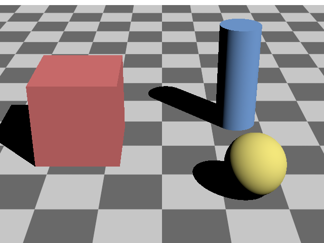
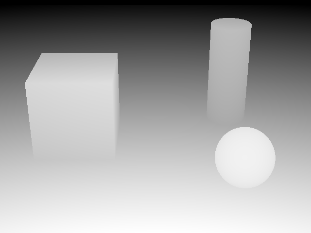
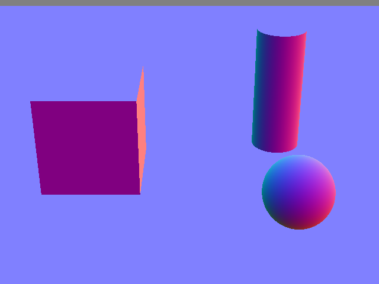
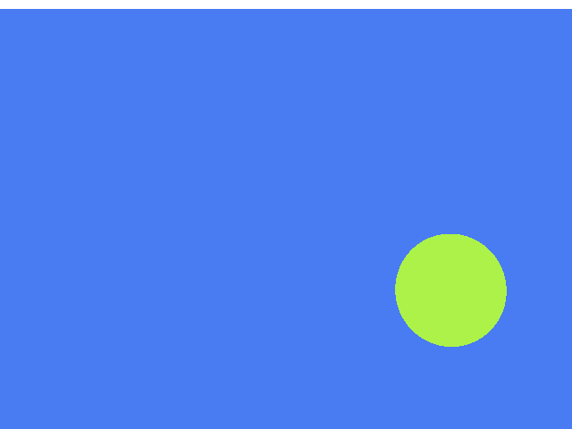
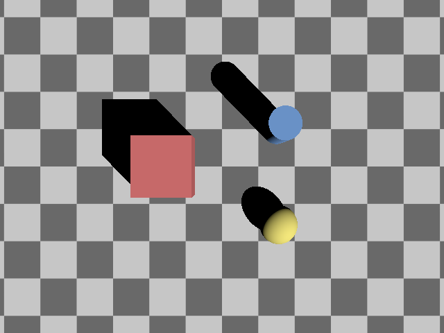
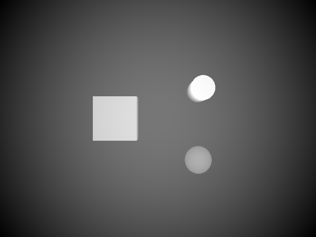
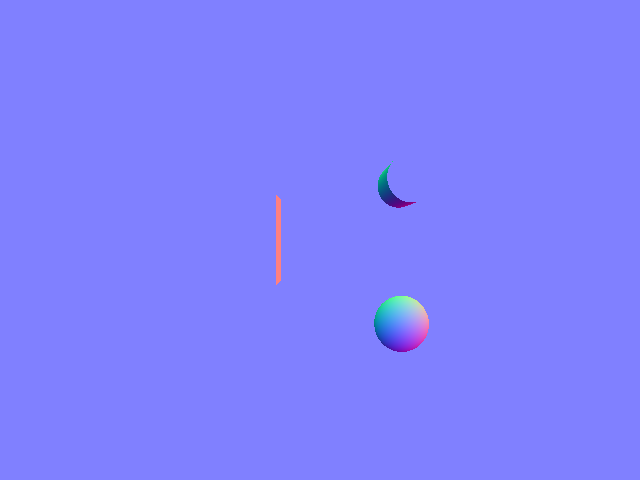

> 🚧 **This project is in active beta development.** This means the API is unstable, features may be added or removed, and breaking changes are likely to occur frequently and without notice as the design is refined.

[](https://github.com/uwsbel/chrono-batch-render/actions/workflows/ci.yml)
[](https://uwsbel.github.io/chrono-batch-render/dev/coverage/)
<!-- [](https://uwsbel.github.io/chrono-batch-render/dev/coverage/) -->
[](https://github.com/uwsbel/chrono-batch-render/releases)
[](https://pypi.org/project/chrono-batch-render/)
[](https://uwsbel.github.io/chrono-batch-render/)
[](https://github.com/uwsbel/chrono-batch-render/blob/main/LICENSE)

# Chrono Batch Render

Chrono Batch Render is a physically-based, real-time, spectral renderer for planetary robotics and sensing.

It is cross-platform and designed with portability in mind, supporting Linux, Windows, and macOS with C++ and Python APIs, and both hardware and software ray tracing support across NVIDIA and AMD GPUs and Apple silicon.

The scene description is modeled on OpenUSD. It is schema-driven with prims at hierarchical paths that have attributes. Unlike OpenUSD, the scene lives on the GPU by design, so render outputs and scene data can be shared zero-copy with other GPU-accelerated applications.

Chrono Batch Render is also built to fit into other applications, whether that's visualizing a physics simulation, rendering large-scale terrain or simulating high-fidelity sensors. It offers fast interfaces behind a simple API, and the bundled viewer is easy to customize for your own application.

A brief overview of its features:

- **Extensible:** custom materials, BRDFs, and sensor filters
- **Configurable fidelity:** built-in rendering modes ranging from low-fidelity RL high-throughput cases to predictive spectral path tracing
- **Zero-copy tensors:** render outputs and scene data (transforms, vertices, lights) are shared via DLPack with PyTorch, JAX, Warp and Numpy
- **Batched rendering:** many sensors and worlds rendered in one step for RL
- **Spectral light:** 8 bands spread over each camera's own spectral range, from the visible to thermal infrared, with RGB inputs uplifted to spectra
- **Physical lighting:** distant, dome, rect, disk, cylinder and sphere lights in physical units (nits, lux or lumens), with blackbody, CIE daylight or measured illuminant spectra, IES profiles and light linking
- **Materials:** UsdPreviewSurface with normal and detail maps and triplanar projection, Lambert and GGX lobes, ITU-R P.2040 radar materials, and your own materials in Slang
- **Cameras:** perspective, orthographic and spherical projections, Brown-Conrady, Kannala-Brandt, f-theta and lookup-table lens distortion, and depth of field
- **Optics and detector effects:** diffraction, glare, blooming and vignetting, EMVA 1288 sensor noise, Bayer, RCCB and RCCC mosaics, demosaicing, auto exposure and tone mapping, with your own filters in Slang
- **Thermal infrared:** Planck emission with emissivity from Kirchhoff's law, and temperatures per prim or per vertex and face from your solver
- **Precision at any scale:** double-precision transforms and a camera-relative render origin for each world
- **OpenXR:** OpenXR headsets with controllers, haptics, hand and eye tracking, pointers and smooth, grounded or fly locomotion, plus a simulated headset for testing without hardware, from C++, Python or the viewer's XR panel
- **Benchmarks:** a harness that renders the same scenes through Chrono Batch Render, Newton, NVIDIA's ovrtx and Madrona under the same timing rules, measuring throughput and scaling

For a more detailed overview of the features, see our [documentation](https://uwsbel.github.io/chrono-batch-render/).

Future work:

- Integrations into Chrono Sensor, Newton Viewer and Isaac Lab
- OpenUSD and glTF support, plus 3D Tiles, OpenPBR, MaterialX and MDL
- Virtual textures and paging techniques
- Terrain level-of-detail
- Laser lights for structured light
- Reflections and global illumination
- Volumetric rendering
- Motion blur and rolling shutter
- Atmospheres
- Gaussian splat and particle fields
- Animation and skinning
- Differentiable rendering
- Spectral benchmarks, with Mitsuba 3's spectral variants as the reference and ovrtx's spectral mode as a comparison

## Quick Start

We recommend installing Chrono Batch Render from PyPI. We also ship a GUI application that provides interactive viewing and editing of scenes. The following commands install Chrono Batch Render, check that it installed successfully and open the GUI.

```sh
pip install chrono-batch-render
python -c "import chrono_batch_render; print(chrono_batch_render.__version__)"
chrono-batch-render # Opens the GUI
```

In Python, basic API usage involves creating a `Scene` with some objects. Then creating a `Renderer` with that `Scene` and calling `Renderer.step` with the desired render products. See below for an example.

```python
import chrono_batch_render

scene = chrono_batch_render.Scene()

chrono_batch_render.Plane.define(
    scene,
    "/Ground",
    width=20,
    length=20,
    checkerboard=True,
)
chrono_batch_render.Cube.define(
    scene,
    "/Box",
    translate=(-1.5, 0, 0.75),
    size=1.5,
    display_color=(0.8, 0.2, 0.2),
)
chrono_batch_render.Cylinder.define(
    scene,
    "/Post",
    translate=(1.5, 1, 1),
    radius=0.4,
    height=2,
    display_color=(0.2, 0.4, 0.8),
)
ball = chrono_batch_render.Sphere.define(
    scene,
    "/Ball",
    radius=0.5,
    display_color=(0.9, 0.8, 0.2),
    semantics_labels={"class": ["ball"]},
)

chrono_batch_render.DistantLight.define(
    scene,
    "/Sun",
    orient=chrono_batch_render.from_azimuth_elevation(135, 45),
    intensity=50000,
)

chrono_batch_render.Camera.define(
    scene,
    "/Front",
    translate=(0, -9, 5),
    orient=chrono_batch_render.look_at((0, -9, 5), (0, 0, 0.5)),
    focal_length=35,
)
chrono_batch_render.Camera.define(
    scene,
    "/Top",
    translate=(0, 0, 14),
    orient=chrono_batch_render.look_at((0, 0, 14), (0, 0, 0), up=(0, 1, 0)),
    focal_length=24,
)

chrono_batch_render.GradientBackground.define(scene, "/Sky")
chrono_batch_render.Scope.define(scene, "/Render")
chrono_batch_render.RenderVar.define(scene, "/Render/Color", source_name="LdrColor")
chrono_batch_render.RenderVar.define(scene, "/Render/Depth", source_name="DistanceToCamera")
chrono_batch_render.RenderVar.define(scene, "/Render/Normal", source_name="Normal")
chrono_batch_render.RenderVar.define(scene, "/Render/Semantic", source_name="SemanticSegmentation")
chrono_batch_render.RenderProduct.define(
    scene,
    "/Render/Views",
    camera=["/Front", "/Top"],
    resolution=(640, 480),
    ordered_vars=["/Render/Color", "/Render/Depth", "/Render/Normal", "/Render/Semantic"],
    render_mode="RealTime",
    background="/Sky",
)

renderer = chrono_batch_render.Renderer(scene)
for step in range(4):
    ball.translate = (step - 1.5, -1.5, 0.5)
    scene.advance(1 / 30)
    output = renderer.step(["/Render/Views"])
    output.wait()
    [frame] = output["/Render/Views"].frames
    for var in frame.render_vars:
        aov = frame.render_var(var)
        for camera, name in enumerate(["front", "top"]):
            chrono_batch_render.write_render_var(f"{name}_{aov.source_name}_{step}", aov, camera)
```

<table>
  <tr>
    <th></th>
    <th>Color</th>
    <th>Depth</th>
    <th>Normal</th>
    <th>Semantic</th>
  </tr>
  <tr>
    <th>Front</th>
    <td></td>
    <td></td>
    <td></td>
    <td></td>
  </tr>
  <tr>
    <th>Top</th>
    <td></td>
    <td></td>
    <td></td>
    <td></td>
  </tr>
</table>

For more advanced code snippets and API usage such as zero-copy interop, batched rendering, cloning, and custom materials see our [guides](https://uwsbel.github.io/chrono-batch-render/latest/guides/).

For more information about Chrono Batch Render's requirements, Python and C++ installation, or other installation methods such as Docker and building from source, see our [installation guide](https://uwsbel.github.io/chrono-batch-render/latest/installation/).

## Citation

If you use Chrono Batch Render in your research, please cite it. GitHub's "Cite this repository" button gives the same citation from [CITATION.cff](https://github.com/uwsbel/chrono-batch-render/blob/main/CITATION.cff).

```bibtex
@software{maietta2026chronobatchrender,
  author  = {Maietta, Alex},
  title   = {Chrono Batch Render},
  year    = {2026},
  version = {0.1.0},
  url     = {https://github.com/uwsbel/chrono-batch-render},
  license = {BSD-3-Clause}
}
```

## License

Chrono Batch Render is licensed under the [BSD 3-Clause License](https://github.com/uwsbel/chrono-batch-render/blob/main/LICENSE).

## Acknowledgements

<!-- --8<-- [start:acknowledgements] -->
Chrono Batch Render is built on these open-source projects.

- [Vulkan Headers](https://github.com/KhronosGroup/Vulkan-Headers), [volk](https://github.com/zeux/volk) and [Vulkan Memory Allocator](https://github.com/GPUOpen-LibrariesAndSDKs/VulkanMemoryAllocator) for the GPU layer
- [Slang](https://github.com/shader-slang/slang) for shaders
- [DLPack](https://github.com/dmlc/dlpack) for sharing tensors with PyTorch, JAX, Warp and NumPy
- [nanobind](https://github.com/wjakob/nanobind) for the Python bindings
- [OpenEXR and Imath](https://github.com/AcademySoftwareFoundation/openexr), [stb](https://github.com/nothings/stb), [Basis Universal](https://github.com/BinomialLLC/basis_universal) and [bc7enc_rdo](https://github.com/richgel999/bc7enc_rdo) for images and textures
- [NanoVDB](https://github.com/AcademySoftwareFoundation/openvdb) for volumes
- [nlohmann/json](https://github.com/nlohmann/json) for JSON
- [{fmt}](https://github.com/fmtlib/fmt) for text formatting
- [tinyobjloader](https://github.com/tinyobjloader/tinyobjloader) for OBJ import
- [MikkTSpace](https://github.com/mmikk/MikkTSpace) for tangents
- [NVTX](https://github.com/NVIDIA/NVTX) for profiling
- [OpenUSD](https://openusd.org/) for scene interchange
- [Dear ImGui](https://github.com/ocornut/imgui) and [GLFW](https://github.com/glfw/glfw) for the viewer
- [GoogleTest](https://github.com/google/googletest) for tests
- [Google Benchmark](https://github.com/google/benchmark) for benchmarks

Chrono Batch Render also leverages ideas from these renderers and projects:

- [Madrona](https://madrona-engine.github.io/) for batch rendering across many worlds
- [Chrono::Sensor](https://api.projectchrono.org/group__sensor.html) for sensor simulation inside Chrono
- [Cycles](https://www.cycles-renderer.org/), [Mitsuba 3](https://www.mitsuba-renderer.org/) and [PBRT](https://pbrt.org/) for physically based and spectral rendering
- [OpenUSD](https://openusd.org/) and Omniverse Fabric for the schema-based scene
- [ovrtx](https://github.com/NVIDIA-Omniverse/ovrtx) for zero-copy interops and USD-based rendering
- [nvpro-samples](https://github.com/nvpro-samples) for Vulkan ray tracing and cluster LOD
- [PANGU](https://pangu.software/) for planetary and asteroid surface simulation
- [IRIS](https://dartslab.jpl.nasa.gov/References/pdf/IRIS_aiaa2022SciTech.pdf) for real-time, closed-loop rendering of space sensors
- [CosmoScout VR](https://github.com/cosmoscout/cosmoscout-vr) for planet-scale scenes and solar-system visualization
- [three-geospatial](https://github.com/takram-design-engineering/three-geospatial) for atmospheres and clouds
- [Isaac Lab](https://github.com/isaac-sim/IsaacLab) and [Newton](https://github.com/newton-physics/newton) for tiled cameras in robot learning
<!-- --8<-- [end:acknowledgements] -->
